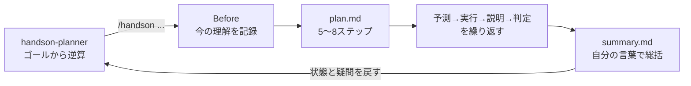

# study-handson

AIが主催、自分が参加者の **1on1ハンズオン勉強会** の記録リポジトリ。
ローカルで完結する環境で手を動かし、理解を言葉にしてAIに確認してもらい、最後は「自分の言葉で、かつ間違っていない総括」を残す。

## 使い方

Claude Code をこのリポジトリで起動して使う。

| やりたいこと | コマンド |
|---|---|
| 広いテーマから学習計画を立てる | `/handson-planner Dockerを勉強したい` |
| 次に何をやるか提案してもらう | `/handson-planner 次は何をやる？` |
| ハンズオンを始める | `/handson Dockerのネットワークを理解したい` |
| 中断したハンズオンを再開する | `/handson 続き` |

### ハンズオン中の合図

| 合図 | AIの動き |
|---|---|
| `ヒント` | ヒントだけ出す |
| `答え` | 答えを出し、そのあと自分の言葉で言い直す |
| `寄り道` | 本筋外の質問。深ければ「後回し」に積む |
| `次` | 判定を保留して次のステップへ |
| `中断` | 現在地を記録して終わる |

## 流れ



1. **計画**（handson-planner）：過去の記録と今の理解から、ゴールを起点に基礎まで逆算して `roadmaps/<theme>.md` を作る
2. **Before**：始める前の理解を3行で記録する（訂正しない）
3. **ステップ**：予測 → 自分でコマンドを打つ → 自分の言葉で説明 → AIが ✅ / ⚠️ / ❌ で判定
4. **総括**：`summary.md` は自分で書く。AIは書き直さず、誤り・曖昧さ・抜けを質問で返す
5. **締め**：状態と「まだ分からないこと」をロードマップに戻し、次の提案につなげる

## 構成

```
.
├─ .claude/skills/
│  ├─ handson/SKILL.md          # 1on1ハンズオンの進め方
│  └─ handson-planner/SKILL.md  # 学習計画と次のおすすめ
├─ _template/                   # セッションの雛形
│  ├─ plan.md
│  ├─ log.md
│  └─ summary.md
├─ roadmaps/                    # テーマごとの学習計画
│  └─ <theme>.md
└─ sessions/                    # 各回の記録
   └─ YYYY-MM-DD-<slug>/
      ├─ plan.md
      ├─ log.md
      ├─ summary.md
      └─ work/                  # 手を動かすファイル
```

## ルール

- コマンドは自分で打つ（AIは実行しない）
- 答えはすぐもらわない。説明してみて、ズレを1点ずつ直す
- AIの説明と実行結果が食い違ったら、実行結果を信じる
- 総括は自分で書く
